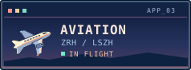

  

# Manuel Frick

I work in **Service Management & Operations** in Zürich, Switzerland. I spend most of my time making Microsoft 365, cloud infrastructure and Modern Workplace easier to run. My favourite thing to automate is the task someone has to remember to do every week.

  
  
  

## Cloud and automation

**PowerShell** is where I start when a problem keeps coming back. I use it with **Microsoft Graph** and other APIs to turn repeatable work into scripts, workflows and health checks.

| Area | What I work with |
| :--- | :--- |
| Modern Workplace | Microsoft 365, Azure, Entra ID and Intune |
| Endpoint operations | Windows, macOS, identity and security |
| Service management | ITSM, System Center Service Manager and improving day-to-day service workflows |

## Web and integrations

I build small web projects and tools with **HTML, CSS, JavaScript and TypeScript**. On the integration side, I work with **APIs, JSON, YAML and SQL**. I like getting a tool down to the few steps someone needs to use it.

## After hours

I’m usually reading about aviation, planning a city trip or looking for somewhere new to explore in Japan. I also miss the personal sites and pixel-art forum signatures of the early web. That’s where the idea for this little Zürich departures hall came from.

I speak **German** (native), **English** (C1) and conversational **Dutch**, and I’m learning **Japanese**.

  

Fictional departures · <a href="https://frick.tech">frick.tech</a>

