<p align="center">
  
</p>

<h1 align="center"><samp>the-frickman.exe</samp></h1>
<p align="center"><samp>Manuel’s personal homepage &nbsp;·&nbsp; Zürich, Switzerland</samp></p>

Grüezi! I’m **Manuel Frick**. I work in **Service Management & Operations**, mostly around Microsoft 365, endpoints and the scripts that keep a service desk moving. After hours, my browser tabs tend to fill up with city maps, Japanese vocabulary and airport timetables. One of those timetables found its way onto this page.

<p align="center">
  <a href="#operationscmd"></a>
  <a href="#indexhtml"></a>
  <a href="#departuresexe"></a>
</p>

## departures.exe

Five upcoming departures from my home airport, in **Zürich local time**. Watch the pair of green lamps on the left. When the airport calls passengers to the gate, the lamps take turns lighting up. When a flight drops off the list, the flights behind it move up and a new destination clicks into the last row.

<p align="center">
  <a href="https://www.flughafen-zuerich.ch/en/passengers/fly/flightinformation/departures"></a>
</p>

<details>
<summary><samp>F1 · How fresh is the board?</samp></summary>

The updater checks Zürich Airport on a five-minute schedule. **BOARD UPDATED** gives the local time of the last published change. GitHub can delay a check or cache an image. Reload the profile to see a newer snapshot, or click the board for the airport’s current gate calls.

When the image loads, all five rows flip into place. Once the letters settle, the board plays back the latest changes to the flight list. Each character has two faces and a hinge. The top half falls forward to reveal the next letter, and each drum stops when it reaches the right character. With reduced motion enabled, the letters appear in their final positions. The timing and alternating lamps were inspired by the [Frankfurt departures board](https://youtu.be/cj32w5z81Ak).

</details>

## operations.cmd

The question I want a health check to answer is *“What should the next person on shift do with this?”* A red light tells someone to look. A device name, a timestamp and the check that failed give them somewhere to start.

| At the desk | What I reach for |
| --- | --- |
| Repeating the same tenant check | PowerShell, Microsoft Graph and APIs |
| Tracking down a sign-in or device issue | Entra ID, Intune, Windows and macOS |
| Looking after workplace services | Microsoft 365 and Azure |
| Handing an incident to the next shift | ITSM, System Center Service Manager and a short account of what I’ve already tried |

## index.html

My web workbench is **HTML, CSS, JavaScript and TypeScript**, with **JSON, YAML and SQL** for the data behind a page. This profile gave me a particularly good excuse to tinker. A single gate change on the board might leave four whole rows alone and send just one little drum spinning.

I miss being able to right-click a personal homepage, choose **View Source**, and find the bit that made something move. You can do that here. The artwork is SVG, and the Python that turns the airport feed into flap positions lives alongside it. [View the board generator](./scripts/build_departures.py)

## profile.ini

```ini
[home]
handle  = the-frickman
city    = Zürich
airport = ZRH / LSZH

[languages]
German   = native
English  = fluent (C1)
Dutch    = conversational
Japanese = learning
```

Away from the desk I’m into aviation, city trips and Japan. Give me a window seat and I’ll happily spend part of the flight matching the view outside to a map.

## favorites.htm

Every good personal homepage had a little folder of links worth keeping. Here’s mine.

- **Homepage** — my own address on the web. [frick.tech](https://frick.tech)
- **At the airport** — the full departure list, including flights beyond the five on this page. [Zürich Airport](https://www.flughafen-zuerich.ch/en/passengers/fly/flightinformation/departures)
- **Behind the board** — open the latest run to see when the updater checked in. [Departures workflow](https://github.com/the-frickman/the-frickman/actions/workflows/departures.yml)

<details>
<summary><samp>C:\ZRH&gt; TYPE README_2005.NFO</samp></summary>

Remember the MSN Messenger away message that was really a song lyric? Or finding a whole new corner of the web through an 88×31 button in somebody’s sidebar? That’s the bit of the 2000s I wanted to bring here. A small page, a few doors to open, and one gloriously specific thing the webmaster spent far too long getting right.

In this case, it was the blink on the left of the board. Thanks for stopping by. See you at the gate!

</details>

<p align="center"><samp>[ <a href="#the-frickmanexe">back to top</a> ] &nbsp;·&nbsp; [ <a href="https://frick.tech">home</a> ]</samp></p>
