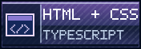

<p align="center">
  
</p>

<h1 align="center">Manuel Frick</h1>

<p align="center">
  <samp><b>WELCOME TO THE-FRICKMAN.EXE</b></samp><br />
  <sub>Zürich, Switzerland &nbsp; · &nbsp; ZRH / LSZH &nbsp; · &nbsp; <a href="https://frick.tech">frick.tech</a></sub>
</p>

<p align="center">
  <a href="#cloud-and-automation"></a>
  <a href="#web-and-integrations"></a>
  <a href="#after-hours"></a>
</p>

## Who am I

Hey, I’m **Manuel**. I work in **Service Management & Operations**, mainly around Microsoft 365, cloud infrastructure and Modern Workplace. I like taking the little jobs that interrupt someone’s day and making them routine, whether that means a PowerShell script, a clearer service workflow or a small tool with the right buttons.

```ini
[profile]
handle = the-frickman
home_base = Zürich (ZRH / LSZH)
first_tool = PowerShell
interests = aviation, city trips, Japan, the early web
```

## Cloud and automation

**PowerShell** is where I start when a problem keeps coming back. I use it with **Microsoft Graph** and other APIs for repeatable health checks, scripts and workflows. My favourite scripts are the ones you can read six months later and still see exactly what they do.

| On the workbench | Tools and platforms |
| :--- | :--- |
| Modern Workplace | Microsoft 365, Azure, Entra ID and Intune |
| Endpoint operations | Windows, macOS, identity and security |
| Service management | ITSM, System Center Service Manager (SCSM) and service workflows |
| Scripting and automation | PowerShell, Microsoft Graph and API integrations |

### At the operations desk

The interesting part of operations is the handoff. A health check should tell the next person what it checked and where to look when it fails. A service workflow should make it clear what’s waiting, what’s done and who has the next step. I like working on those details because they make busy days easier.

## Web and integrations

I build web projects with **HTML, CSS, JavaScript and TypeScript**, and work with **JSON, YAML and SQL** when there’s data to connect or reshape. I enjoy making a small utility easy to use, from naming the first button to handling the case where the API comes back empty.

This profile is a side project in the same spirit. The buttons are little app windows, the header is pixel art, and the departures board is animated SVG. It’s the kind of personal homepage I liked finding through a forum signature.


## After hours

I’m usually reading about aviation, planning a city trip or looking for somewhere new to explore in Japan. I have a soft spot for airport signs, Alpine runways at dusk and the sound of a mechanical departures board catching up all at once.

| Language | Level |
| :--- | :--- |
| German | Native |
| English | Fluent (C1) |
| Dutch | Conversational |
| Japanese | Learning |

<p align="center">
  
</p>

<p align="center"><sub><samp>ZRH / LSZH &nbsp; · &nbsp; FICTIONAL DEPARTURES</samp></sub></p>

<details>
<summary><samp><b>OPEN README_2005.NFO</b></samp></summary>

```text
+-------------------------------------+
| THE-FRICKMAN.EXE                    |
|                                     |
| Things I miss about the old web     |
|   01  Links in forum signatures     |
|   02  App-window homepage buttons   |
|   03  Oddly specific personal sites |
|                                     |
| NEXT STOP: frick.tech               |
+-------------------------------------+
```

</details>

<p align="center"><samp>SEE YOU AT THE GATE &nbsp; · &nbsp; <a href="https://frick.tech">FRICK.TECH</a></samp></p>
