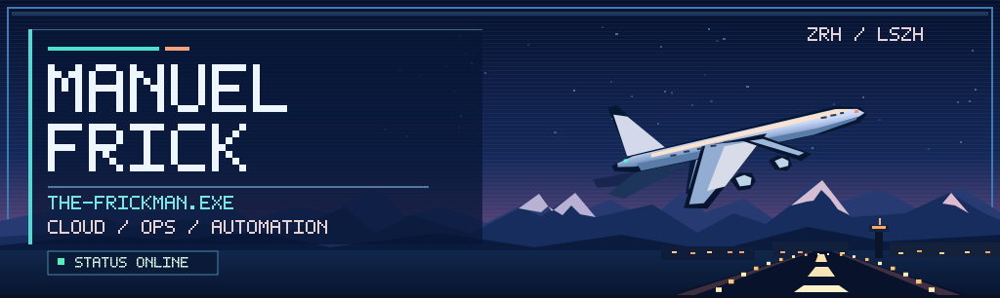
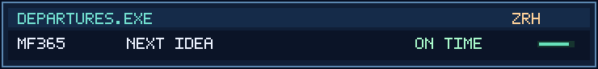

<!-- Welcome to a small corner of the early-2000s internet.
     Artwork is original, local SVG, with no external badge/CDN dependency. -->

<p align="center">
  
</p>

<p align="center">
  <samp><b>WELCOME TO MY LITTLE CORNER OF THE INTERNET</b></samp><br/>
  <samp>EST. IN THE ERA OF FORUMS, PIXEL FONTS &amp; GUESTBOOKS</samp>
</p>

<p align="center">
  <a href="#01--whoami"></a>
  <a href="#02--toolkitini"></a>
  <a href="#04--after-hours"></a>
</p>

<p align="center">
  <code>MANUEL.EXE</code> &nbsp; · &nbsp; <code>@the-frickman</code> &nbsp; · &nbsp; <code>ZRH / LSZH</code>
</p>

---

### `01 // whoami`

Hey, I'm **Manuel**. I work in **Service Management & Operations**, with a soft spot for **Microsoft 365, cloud infrastructure, Modern Workplace and automation**.

I like solving messy operational problems, turning manual routines into reliable scripts, and building things that are both useful *and* a little fun. My default troubleshooting tool is PowerShell. My default daydream involves an airport.

```text
C:\> WHOAMI

  NAME       Manuel Frick
  HOME BASE  Zurich, Switzerland (ZRH / LSZH)
  FOCUS      Service Operations / M365 / Modern Workplace
  MISSION    Simplify > Automate > Improve
  MODE       Curious by default

  [=========================] SYSTEM ONLINE
```

### `02 // toolkit.ini`

| File type | What you'll find |
| :--- | :--- |
| **`automation.ps1`** | PowerShell, scripting, Microsoft Graph, workflow automation |
| **`frontend.html`** | HTML, CSS, JavaScript, TypeScript |
| **`cloud.config`** | Microsoft 365, Azure, Entra ID, Intune |
| **`systems.sys`** | Windows, macOS, endpoints, identity and security |
| **`operations.log`** | ITSM, SCSM, service management, operational improvements |
| **`data.json`** | JSON, YAML, SQL and API integrations |

*More interested in useful solutions than collecting logos.*

### `03 // human_languages.cfg`

| Language | Level |
| :--- | :--- |
| **German** | Native |
| **English** | Fluent (C1) |
| **Dutch** | Conversational |
| **Japanese** | Learning |

### `04 // after_hours`

When I'm not dealing with tenants, endpoints or automation, I'm probably reading about **aviation**, exploring a new city, planning a trip to **Japan**, or tinkering with a side project.

Also: I miss the internet of **personal homepages, forum signatures, 88×31 buttons, pixel fonts and silly little Easter eggs**. This profile is a tribute to that era, minus the autoplay MIDI.

### `05 // currently_loading`

- Better tools for **service operations** and **repeatable health checks**
- Practical **PowerShell** and Microsoft 365 automation
- Building and experimenting with **web projects**
- The next airport, the next idea, the next rabbit hole

<details>
<summary><b>🖥️ Open README_2005.nfo</b></summary>

```text
+---------------------------------------------------------+
|  WELCOME, INTERNET TRAVELLER!                            |
|                                                         |
|  Best viewed with curiosity and a healthy dose          |
|  of 2000s nostalgia.                                     |
|                                                         |
|  [x] Pixel art                  [x] No visitor counter  |
|  [x] Old-school web buttons     [x] No autoplay MIDI    |
|                                                         |
|  Thanks for stopping by. See you at the gate!            |
+---------------------------------------------------------+
```

</details>

---

<p align="center">
  
</p>

<p align="center">
  <sub><samp>BUILT WITH CODE, CURIOSITY &amp; A LITTLE BIT OF NOSTALGIA · <a href="https://frick.tech">FRICK.TECH</a></samp></sub>
</p>
